<h1 align="center">Umbry</h1>

One cinematic client for Jellyfin, Emby &amp; Plex — with an optional self-hosted sync server.

---

**Umbry** is a single, themeable media player for **Jellyfin**, **Emby**, and **Plex**, plus an optional companion server that syncs your setup across devices. This repository holds both:

- **[`player/`](player/)** — the **Umbry Player**: the media-player client (a fork of [Jellyfin Web](https://github.com/jellyfin/jellyfin-web)). Cinematic UI, 17 themes, built-in free Live TV, a cross-server watchlist, and a PIN-locked Kids Mode. Works standalone — no account or server required.
- **[`server/`](server/)** — the **Umbry Server**: a small, self-hostable sync backend (Node + Fastify). *Optional.* It stores only your account settings — saved servers, watchlist, PIN, parental rules, themes — so they follow you across devices. It never touches your media, and it provisions its own secrets on first run, so it self-hosts with zero configuration.

- Website: <https://umbry.org>
- Downloads: <https://umbry.org/#download>

Umbry is an **independent** project and is **not affiliated with, endorsed by, or sponsored by Jellyfin, Emby, or Plex**. All product names, logos, and brands are the property of their respective owners.

## Screenshots

  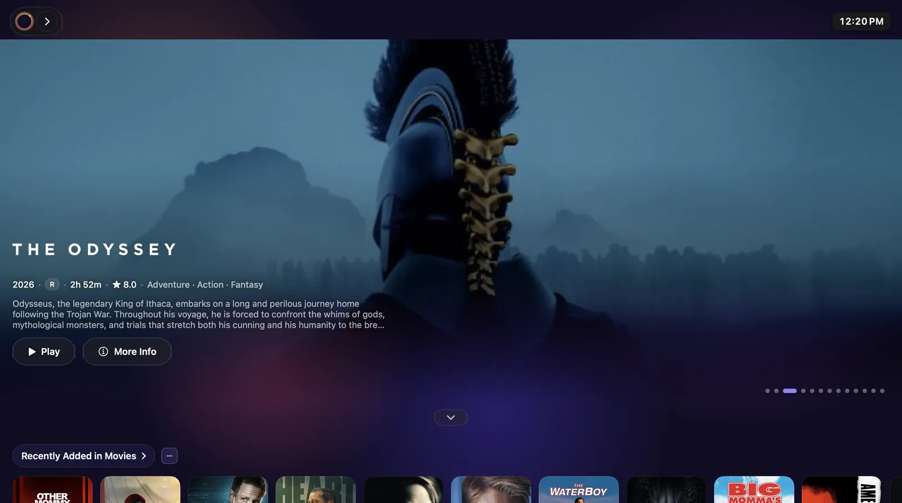

  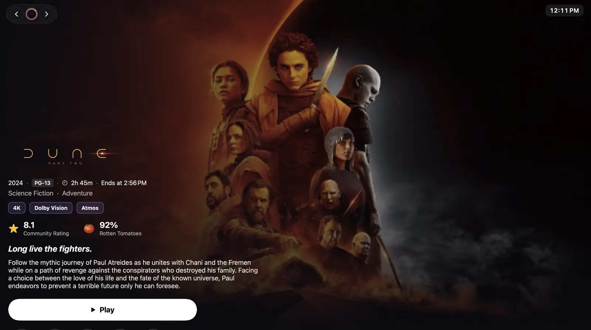
  &nbsp;
  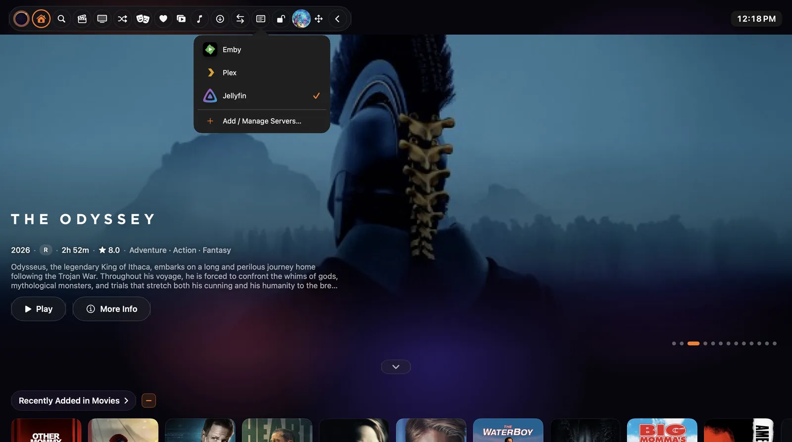

<b>Rich detail pages</b> with quality badges and ratings &nbsp;·&nbsp; <b>Jellyfin, Emby and Plex</b> in one app, switch in a click

  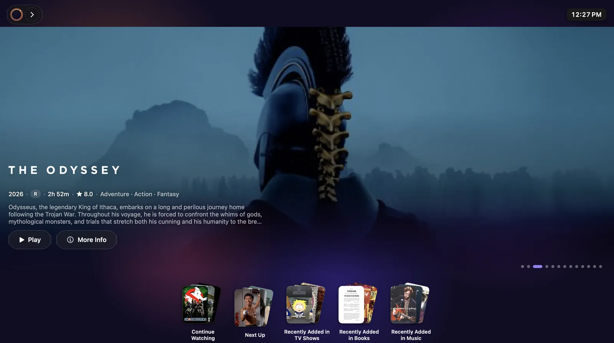
  &nbsp;
  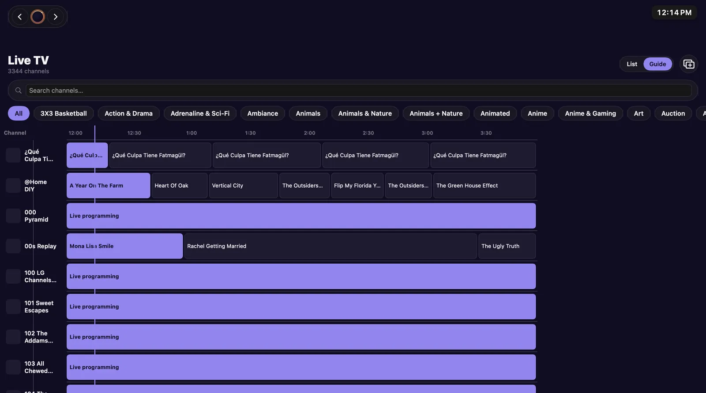

<b>Minimize home rows</b> into a drawer of thumbnail stacks &nbsp;·&nbsp; <b>Free Live TV</b> with a full channel guide

  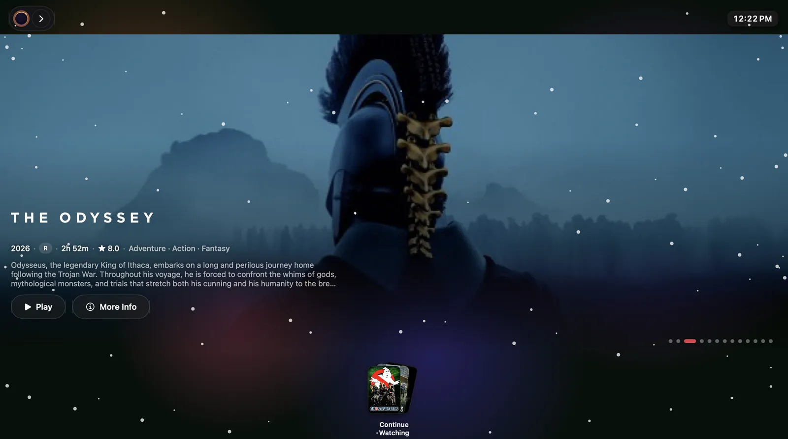
  &nbsp;
  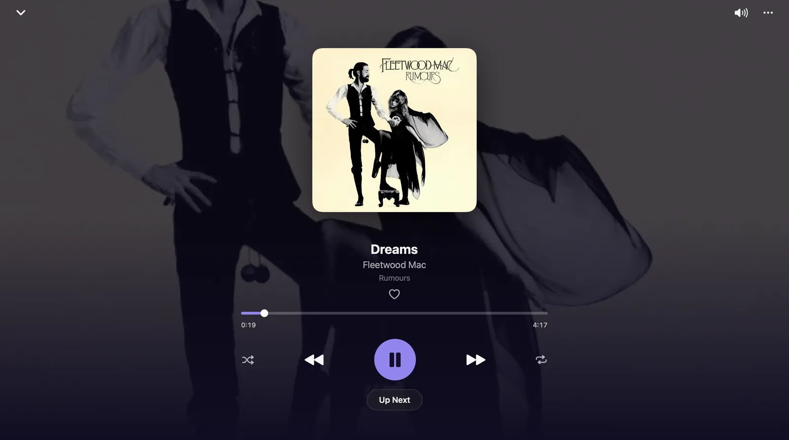

<b>Themes</b>, including seasonal ones with falling snow &nbsp;·&nbsp; a full-screen <b>music player</b>

  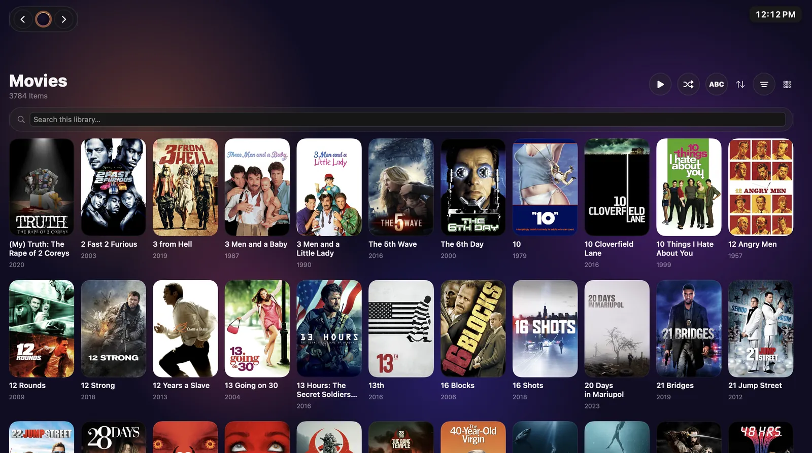
  &nbsp;
  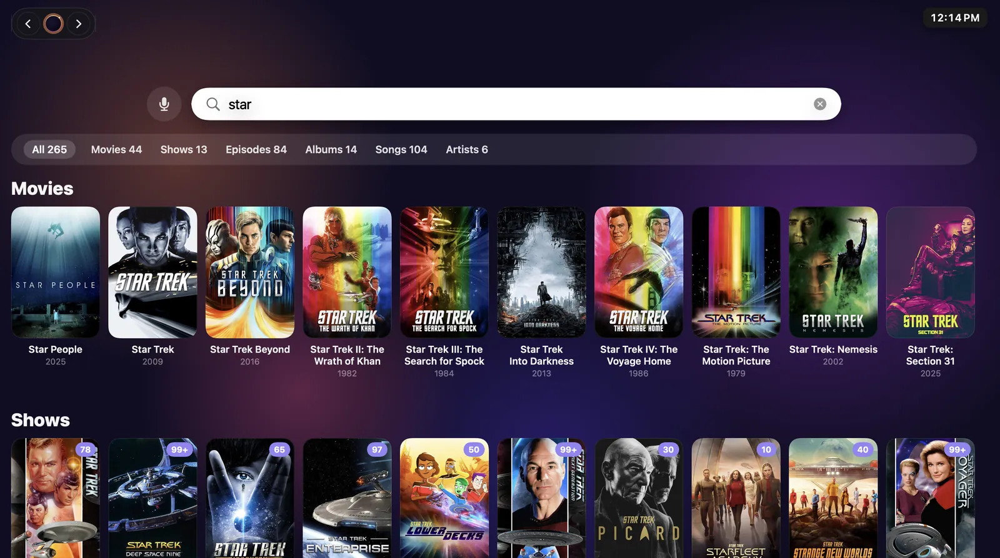

<b>Libraries</b> as poster grids &nbsp;·&nbsp; <b>Search</b> grouped into movies and shows

  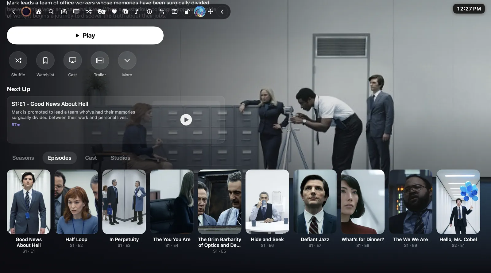
  &nbsp;
  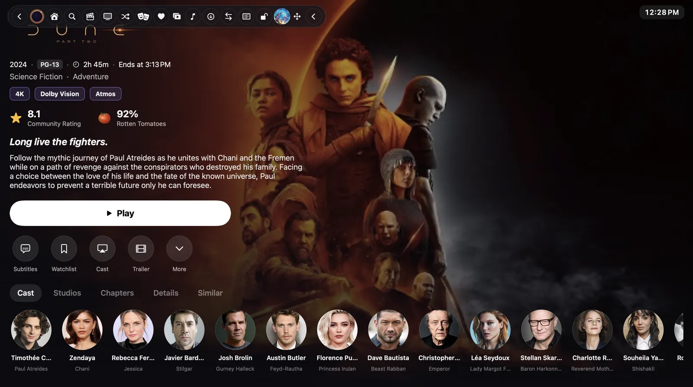

<b>TV shows</b> with Next Up and episodes &nbsp;·&nbsp; <b>Cast &amp; crew</b> with photos

  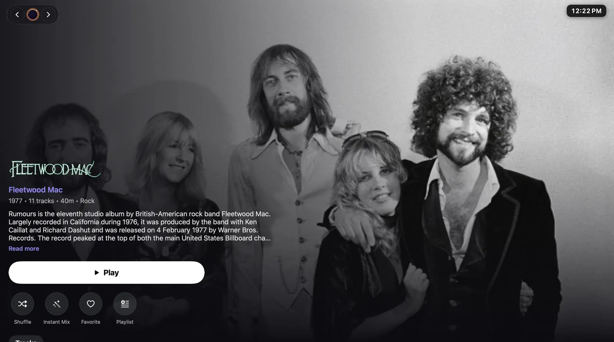
  &nbsp;
  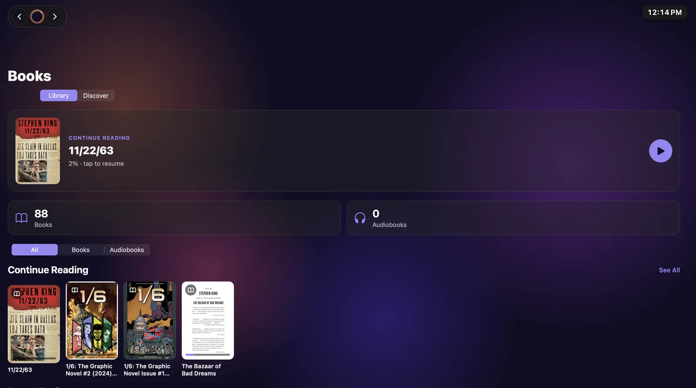

<b>Albums</b> &nbsp;·&nbsp; a <b>Books</b> home with Continue Reading

  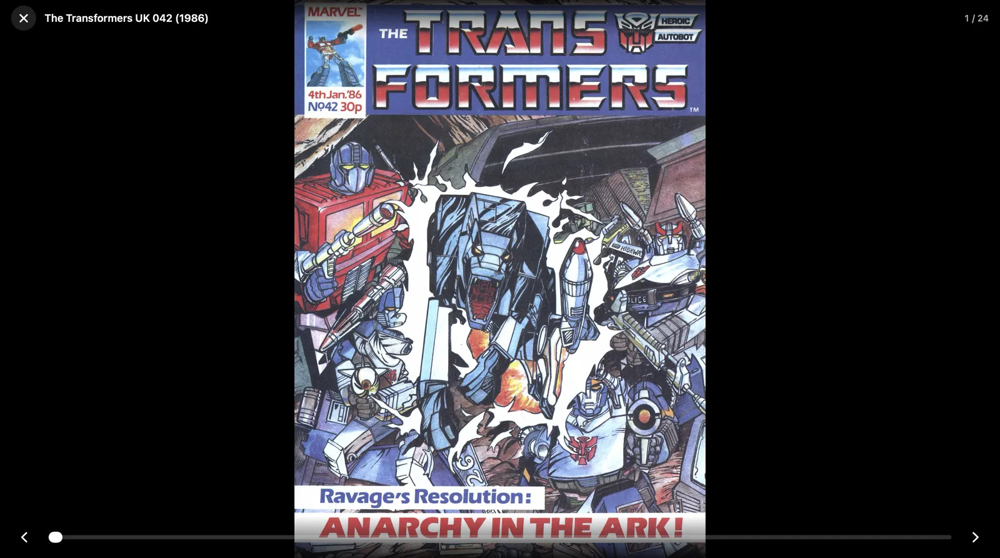
  &nbsp;
  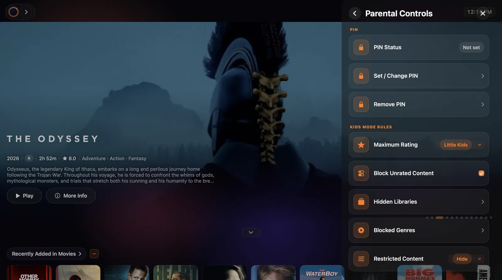

A built-in <b>comic and book reader</b> &nbsp;·&nbsp; <b>Kids Mode</b> with a PIN, rating limit and hidden libraries

## Two ways to run the Player

- **Desktop app** — a native windowed app for Windows, macOS, and Linux. Nothing to configure, no ports. Most people want this: grab it from <https://umbry.org/#download>.
- **Self-hosted web app (Docker)** — serve the Player in a browser at a URL of your own. This is the form you get with a Docker install (below).

## Self-hosting

### Quickest — Docker Compose (both at once)

From the repository root:

    docker compose up -d --build

That builds and starts both services. Open the Player at `http://<host>:8080` and, if you want sync, connect it to the Server at `http://<host>:8790`. Edit [`docker-compose.yml`](docker-compose.yml) to change ports, drop the server, or set options — it's meant to be copied and tweaked.

### Or build each image yourself

**Player (web app):**

    cd player
    docker build -t umbry-player .
    docker run -d -p 8080:80 umbry-player

The container serves on port 80 — map it to **any host port you like** (`8080` is just an example).

**Server (sync backend):**

    cd server
    docker build -t umbry-server .
    docker run -d -p 8790:8790 -v umbry-data:/data umbry-server

The server generates its own signing + encryption keys on first run (kept in the `umbry-data` volume). See [`server/README.md`](server/README.md).

> **Ports at a glance:** the **Server** listens on **8790**; the **Player web-app** container serves on **80** (map to any host port); the **desktop** Player uses no external port at all.

### Build the Player from source (no Docker)

Requires Node 20+.

    cd player
    npm ci
    npm run build:production

The build is written to `player/dist/`, which you can serve with any static web server. See [`player/README.md`](player/README.md).

## License

Umbry is free software under the **GNU General Public License, version 2.0 (GPL-2.0)** — the Player is a fork of Jellyfin Web (GPL-2.0), and the whole project is distributed under the same license. See [LICENSE](LICENSE) and [UMBRY_SOURCE_NOTICE.txt](UMBRY_SOURCE_NOTICE.txt).
